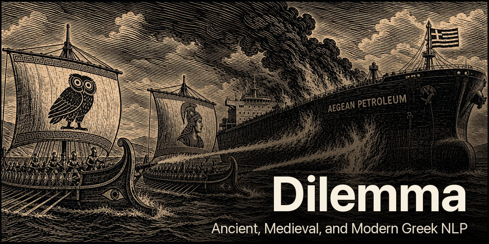

# Dilemma

[](https://github.com/open-greek/dilemma/actions/workflows/test.yml)

<p align="center">
  
</p>

Dilemma finds dictionary headwords for Ancient, Medieval/Byzantine, and Modern
Greek, including Katharevousa. It combines dictionary and corpus lookups,
morphological rules, and a small character-level transformer for unfamiliar
forms. You can use it as a Python library, with or without neural inference.

Dilemma is part of [Open Greek](https://opengreek.org/). It uses corrected texts
from the [Open Greek Corpus](https://github.com/open-greek/open-greek-corpus)
for word frequencies and corpus attestation.

## Install

Python 3.10 or newer is required. Install from PyPI, then download the data:

```bash
python3 -m pip install "dilemma-nlp[onnx]"
python3 -m dilemma download --no-tagger
```

The `onnx` extra enables inference for unseen forms. For lookup and rule-based
analysis without a neural backend, install plain `dilemma-nlp` and use
`guess=False`. The `torch` extra is an alternative if you use PyTorch.

The Python package and its data are separate downloads. The command above
fetches lookup data and lemmatizer weights into `~/.cache/dilemma/`; it skips
POS tagger weights. The data download is several gigabytes. To include the
tagger, omit `--no-tagger`.

Download options:

| Flag | Effect |
|---|---|
| `--with-attestation` | Exact-form attestation and usage distributions |
| `--with-citations` | Example passages, including the attestation data above |
| `--dir PATH` | Writes downloads under a different directory |

Set `DILEMMA_DATA_DIR` to select a particular `data/` directory, and
`DILEMMA_MODEL_DIR` to select a `model/` directory. Without an override, the
lemmatizer checks the download cache, a source checkout, and bundled data,
using the most recently built or downloaded artifacts.

## Lemmatize words

```python
from dilemma import Dilemma

greek = Dilemma()

greek.lemmatize("ἀνθρώπους", guess=False)  # "ἄνθρωπος"
greek.lemmatize("ἔγραψα", guess=False)     # "γράφω"
greek.lemmatize("ἀλλ’", guess=False)       # "ἀλλά"
greek.lemmatize_batch(
    ["λέγουσι", "θεούς"], guess=False
)  # ["λέγω", "θεός"]
```

With `guess=False`, unresolved words return `None`, or an empty list in
verbose mode. Lookup and deterministic rules still run. Tokens without Greek
letters pass through unchanged.

The default, `guess=True`, also tries the transformer when the earlier steps
cannot resolve a word. If no acceptable lemma is found, it returns the input
unchanged. Use `guess=False` when an explicit missing result is preferable.
Constructing `Dilemma` does not import ONNX Runtime or PyTorch; backend checks
and model loading wait until inference is needed.

## Choose a language and dictionary convention

Language selects the lookup tables. Convention selects the dictionary
headword you want in the output.

| Text | Starting point |
|---|---|
| Mixed periods or Katharevousa | `Dilemma()` — combined lookup, Wiktionary citation forms |
| Ancient or literary Byzantine Greek | `Dilemma(lang="grc")` |
| Demotic Modern Greek | `Dilemma(lang="el", convention="triantafyllidis")` |
| LSJ-based work | `Dilemma(lang="grc", convention="lsj")` |
| Homeric work using Cunliffe | `Dilemma(lang="grc", convention="cunliffe")` |

The lemmatizer accepts `lang="all"` (the default), `"grc"`, or `"el"`.
Vernacular medieval forms are included in `el`; classicizing Byzantine forms
are handled by `grc`. Katharevousa often benefits from the combined lookup.
See [language coverage](https://github.com/open-greek/dilemma/blob/main/docs/coverage.md)
for the distinction between period, dialect, and lookup language.

```python
modern = Dilemma(lang="el", convention="triantafyllidis")
modern.lemmatize("εργαλεία", guess=False)  # "εργαλείο"

lsj = Dilemma(lang="grc", convention="lsj")
lsj.lemmatize("εἶπον", guess=False)  # "λέγω"
```

By default, marked Ancient articles keep their own forms: `ἡ` stays `ἡ`, and
a positional grave becomes acute (`τὸ` → `τό`). Set `resolve_articles=True`
for canonical article and pronoun lemmas such as `ὁ` and `ἐγώ`, as used in
many treebanks. The `triantafyllidis` convention enables its Modern Greek
closed-class mappings automatically.

## Work with ambiguous or damaged text

`lemmatize_verbose()` returns candidate lemmas with language, source, score,
and proper-name metadata. Use `lemmatize_pos()` or `lemmatize_batch_pos()`
when you already have part-of-speech tags. A preceding article can also help
rank verbose candidates through `prev_word`.

Reviewed imperfect forms such as `ἀπῇμεν` retain the grammatical lemma
`ἄπειμι`. Their candidate's `grammar` field gives the person, number, tense,
voice, and mood, with `ἀπέρχομαι` recorded separately as a related headword.
When a reviewed form belongs to several verbs, verbose mode keeps each
reading. For example, `ᾖσαν` can come from `εἶμι`, `οἶδα`, or `ἀείδω`,
with a different tense in each analysis. A single-answer call keeps its
existing supported preference; these methods do not resolve same-POS
ambiguity from sentence meaning.
See [verbose mode](https://github.com/open-greek/dilemma/blob/main/docs/usage.md#verbose-mode)
for the fields and source evidence.

For nonstandard historical spelling, enable a normalization profile:

```python
byzantine = Dilemma(normalize=True, period="byzantine")
ionic = Dilemma(dialect="ionic")
```

The library also provides spelling suggestions, Ancient Greek paradigm
generation, corpus attestations and example passages, and repair of corrupt
lemma annotations. The [API guide](https://github.com/open-greek/dilemma/blob/main/docs/usage.md)
explains the options and their data requirements, including
`citation_policy="strict_ag"` for independently supported Ancient Greek
headwords.

Verb exports can include source-backed subject evidence: whether a documented
passive sense takes a person or a thing, or uses an impersonal construction.
This is optional lexical information; unmarked senses remain unknown.

## Tag and parse sentences

Install the ONNX tagger runtime and download its weights:

```bash
python3 -m pip install "dilemma-nlp[tagger-onnx]"
python3 -m dilemma download
```

```python
from dilemma import Tagger

tagger = Tagger(lang="grc")
for token in tagger.tag(["μῆνιν ἄειδε θεὰ Πηληϊάδεω Ἀχιλῆος"])[0]:
    print(token)
```

The tagger returns token dictionaries with lemmas, part-of-speech tags,
morphological features, and dependency relations. Its language options are
`el`, `grc`, and `med`. Training requires the separate `tagger` extra;
inference uses `tagger-onnx`. See the
[tagger guide](https://github.com/open-greek/dilemma/blob/main/docs/tagger.md)
for tokenization, model sources, and device settings.

## Documentation

| Guide | Contents |
|---|---|
| [API](https://github.com/open-greek/dilemma/blob/main/docs/usage.md) | Methods, conventions, spelling, paradigms, verb subjects, and attestation |
| [Language coverage](https://github.com/open-greek/dilemma/blob/main/docs/coverage.md) | Periods, dialects, and language codes |
| [Tagging and parsing](https://github.com/open-greek/dilemma/blob/main/docs/tagger.md) | Sentence annotation, models, and performance |
| [How it works](https://github.com/open-greek/dilemma/blob/main/docs/design.md) | Lookup order, rules, normalization, and model architecture |
| [Evaluation](https://github.com/open-greek/dilemma/blob/main/docs/evaluation.md) | Benchmark methods, recorded results, and limitations |
| [Data](https://github.com/open-greek/dilemma/blob/main/docs/data.md) | Sources, merge rules, confidence tiers, and validation |
| [Development](https://github.com/open-greek/dilemma/blob/main/docs/development.md) | Setup, training, tests, data publication, and releases |
| [Lexicon expansion](https://github.com/open-greek/dilemma/blob/main/docs/lexicon-expansion.md) | LSJ/Sophocles paradigms and form selection |
| [Word lists](https://github.com/open-greek/dilemma/blob/main/docs/word-lists.md) | Frequency-ranked forms, Hunspell dictionaries, and morphology exports |
| [Polytonic Modern Greek](https://github.com/open-greek/dilemma/blob/main/docs/modern-greek.md) | Modern word-list construction and validation |
| [Next-word prediction](https://github.com/open-greek/dilemma/blob/main/docs/language-model.md) | Training, evaluation, and binary export |
| [Monotonic Modern Greek corpus](https://github.com/open-greek/dilemma/blob/main/docs/el-monotonic-corpus.md) | Sources, normalization, tokenization, and split for monotonic text |

Benchmark results depend on the text, citation convention, available context,
and artifact version. Recognition of a spelling and selection of the correct
lemma are different measures. The evaluation guide keeps those measures and
older comparison results separate.

## Development and contributions

```bash
git clone https://github.com/open-greek/dilemma.git
cd dilemma
python3 -m pip install -e ".[dev,onnx,lm]"
./scripts/install_git_hooks.sh
```

The [development guide](https://github.com/open-greek/dilemma/blob/main/docs/development.md)
covers data downloads, rebuild order, model training, testing, and numbered
GitHub/PyPI releases. Generated artifacts are stored on HuggingFace; the
repository manifest records the hashes used by CI.

Report defects and propose changes in
[GitHub issues](https://github.com/open-greek/dilemma/issues). For data errors,
include the input word, expected lemma, language and convention settings, and
the source supporting the correction. The
[changelog](https://github.com/open-greek/dilemma/blob/main/CHANGELOG.md)
records changes by release.

## Projects and credits

- [Lemma](https://github.com/open-greek/lemma) uses Dilemma's frequency-ranked
  forms in a Modern Greek dictionary.
- [Tonos](https://tonospolytonic.com/) uses its Hunspell dictionaries and
  next-word language model in a polytonic Greek keyboard.

Dilemma draws on Wiktionary, LSJ, Sophocles, GLAUx, Diorisis, AGDT, and other
lexica and corpora. The [third-party notices](https://github.com/open-greek/dilemma/blob/main/NOTICE)
list the sources, contributors, licenses, and exclusions. Gorman's treebanks
are reserved for evaluation and excluded from shipped artifacts.

## License

The source code is [MIT licensed](https://github.com/open-greek/dilemma/blob/main/LICENSE).
Data and model artifacts remain subject to their source licenses; see
[NOTICE](https://github.com/open-greek/dilemma/blob/main/NOTICE).
© 2026 Open Greek.
